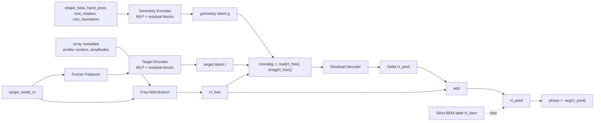

# Hand Phase Surrogate

This document is the single current reference for the MANO hand-conditioned BEM response surrogate.

## Current Artifacts

```text
outputs/hand_phase_surrogate_mvp_v1
outputs/hand_phase_surrogate_mvp_train_nmse_v1
```

- `hand_phase_surrogate_mvp_v1`: completed MVP dataset.
- `hand_phase_surrogate_mvp_train_nmse_v1`: current training run using normalized complex loss.

Generated smoke runs, old raw-MSE runs, pilot reports, paper translations, poster exports, COMSOL scratch outputs, and debug caches are intentionally not kept in the repo workspace.

## Dataset

MVP dataset status:

```text
geometries: 8000 / 8000
labels:     1,024,000
failures:   0
```

Split:

```text
train:      6500 geometries
validation:  750 geometries
test_id:     750 geometries
test_ood:      0 geometries
```

Each `.npz` sample is geometry-level and contains:

| Field | Shape | Meaning |
|---|---:|---|
| `shape_beta` | `(10,)` | MANO shape coefficients |
| `hand_pose` | `(45,)` | MANO hand pose parameters |
| `root_rotation` | `(3,)` | global hand rotation |
| `root_translation_m` | `(3,)` | global hand translation in meters |
| `target_world_m` | `(128, 3)` | target positions |
| `target_category` | `(128,)` | sampling source label, retained for analysis only |
| `response_real` | `(128, 256)` | strict BEM response real part |
| `response_imag` | `(128, 256)` | strict BEM response imaginary part |

`target_category` is not used by the default network because it describes sampling policy rather than acoustic physics.

## Model

The model predicts an additive correction to the analytic free-field response:

```text
H_pred = H_free + Delta H_pred
phase  = -arg(H_pred)
```

Where:

- `H_free`: analytic point-source free-field response.
- `Delta H_pred`: neural prediction of the hand-induced residual.
- `H_pred`: predicted strict-BEM response used for phase-only control.



Default configuration:

| Parameter | Default |
|---|---:|
| `geometry_dim` | `61` |
| `geometry_latent_dim` | `256` |
| `target_latent_dim` | `128` |
| `hidden_dim` | `512` |
| `num_emitters` | `256` |
| `target_fourier_bands` | `8` |
| `target_category_dim` | `0` |
| `geometry_blocks` | `4` |
| `target_blocks` | `3` |
| `decoder_blocks` | `5` |

## Training

Main entry point:

```text
scripts/hand_dataset/train_hand_phase_surrogate.py
```

Recommended current command:

```powershell
C:\Users\Admin\miniconda3\envs\srt\python.exe scripts\hand_dataset\train_hand_phase_surrogate.py `
  --dataset-dir outputs\hand_phase_surrogate_mvp_v1 `
  --output-dir outputs\hand_phase_surrogate_mvp_train_nmse_v1 `
  --epochs 300 `
  --batch-size 4 `
  --target-subsample 64 `
  --lr 2e-4 `
  --device cuda `
  --complex-loss nmse `
  --phase-weight 0.2 `
  --log-amplitude-weight 0.05 `
  --dropout 0.05 `
  --progress-every 100 `
  --progress-seconds 10
```

Resume:

```powershell
--resume latest
```

Training output files:

```text
run_config.json
metrics.jsonl
metrics_table.tsv
latest.pt
best.pt
epoch_XXXX.pt
training_curves.png
```

## Metrics Plot

```powershell
C:\Users\Admin\miniconda3\envs\srt\python.exe scripts\hand_dataset\plot_hand_phase_training_metrics.py `
  --run-dir outputs\hand_phase_surrogate_mvp_train_nmse_v1 `
  --svg
```

The plot script deduplicates repeated epochs after resume and keeps the last record for each epoch.

## Current Lessons

- Raw complex MSE overfits early and is dominated by rare high-amplitude labels.
- Use `--complex-loss nmse` as the current default training objective.
- Judge runs primarily by validation `complex_nmse` and `phase_mae_rad`, not by raw `total` alone.
- If phase error remains close to the free-field baseline, the next architecture change should add relative target encoding or switch to an emitter-conditioned decoder.

